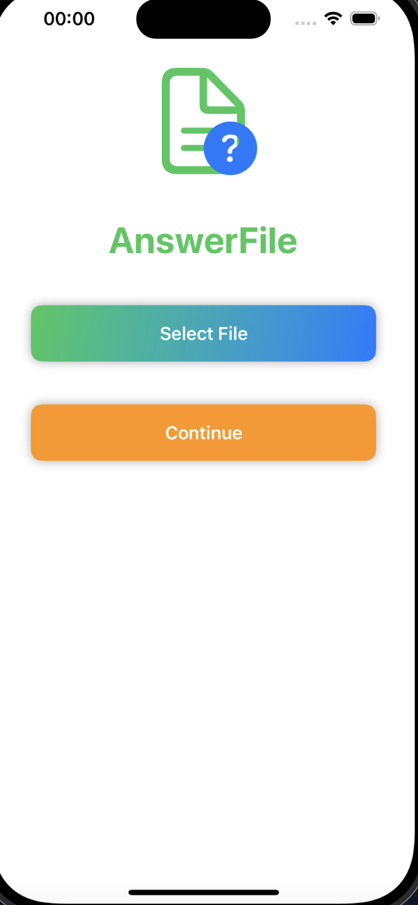
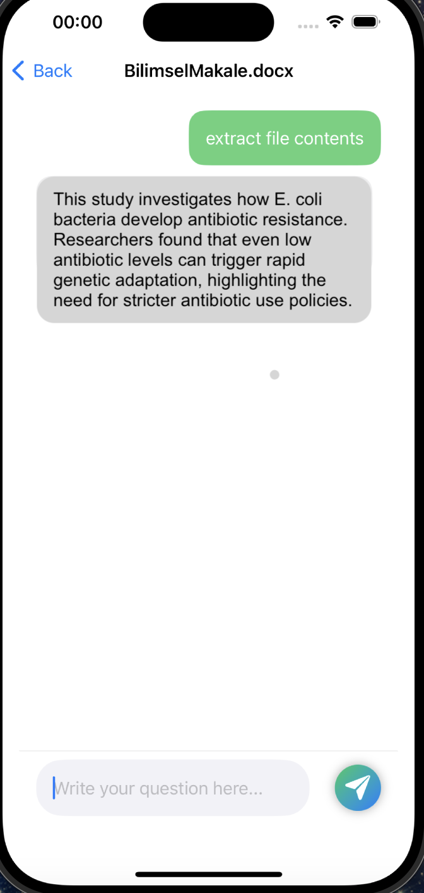

# AnswerFile — Belgelerinize Soru Sorun

**AnswerFile**, iPhone'daki bir PDF, Word, metin dosyası ya da fotoğraf hakkında doğal dille soru sormanızı sağlayan bir iOS uygulamasıdır. Dosyanın içeriği okunur, yapay zekâya bağlam olarak verilir ve cevap sohbet ekranında gösterilir.

> Orion Innovation'daki iOS stajım sırasında (Temmuz–Ekim 2024) Swift ve SwiftUI ile geliştirdim.

<p>
  
  &nbsp;&nbsp;
  
</p>

## Özellikler

- **Çoklu dosya desteği:** PDF, DOCX, TXT ve görseller (JPG, PNG, HEIC, TIFF, BMP)
- **Belge üzerinde soru-cevap:** Dosya metni ve kullanıcının sorusu Google Gemini API'ye gönderilir
- **Görsel analiz:** Fotoğraflardaki nesne, etiket ve yüzler Google Cloud Vision API ile algılanır
- **Sohbet arayüzü:** Mesaj balonları ve yeni mesajda otomatik kaydırma

## Nasıl Çalışır?

```
Dosya seç ──► Dosya türüne göre içerik çıkar ──► Soruyla birlikte API'ye gönder ──► Cevabı göster
              • PDF  → PDFKit
              • DOCX → ZIP aç + document.xml ayrıştır
              • TXT  → UTF-8 / UTF-16 okuma
              • Görsel → Vision API ile metne dönüştür
```

## Teknik Detaylar

| Alan | Kullanılan |
| --- | --- |
| Dil ve arayüz | Swift, SwiftUI, `UIViewControllerRepresentable` (UIKit belge seçici) |
| Yapay zekâ | Google Gemini API (REST), Google Cloud Vision API |
| Dosya işleme | PDFKit, ZIPFoundation, `XMLParser` (DOCX metin çıkarma) |
| Ağ | `URLSession`, `Codable` ile JSON çözümleme, `Result` tabanlı hata yönetimi |
| Güvenlik | API anahtarları koda gömülmez; `Config.plist` dosyasından okunur ve `x-goog-api-key` başlığıyla gönderilir |

**DOCX nasıl okunuyor?** Bir `.docx` dosyası aslında bir ZIP arşividir. Uygulama arşivi ZIPFoundation ile açar, içindeki `word/document.xml` dosyasını bulur ve `XMLParser` ile yalnızca metin düğümlerini toplar.

## Dosya Yapısı

| Dosya | Görevi |
| --- | --- |
| `AnswerFileApp.swift` | Uygulamanın giriş noktası |
| `ContentView.swift` | Ana ekran ve belge seçici |
| `ChatView.swift` | Soru-cevap (sohbet) ekranı |
| `Config.swift` | Gemini API isteği ve yanıt modelleri |
| `APIKey.swift` | API anahtarlarını `Config.plist`'ten okuyan yardımcı |
| `FileUtils.swift` | PDF, TXT, DOCX okuma ve görsel analizi |
| `OfficeOpenXml.swift` | DOCX içinden metin çıkarıcı |

## Kurulum

1. Xcode'da yeni bir **iOS App (SwiftUI)** projesi oluşturun ve bu repodaki `.swift` dosyalarını ve `Config.plist`'i projeye ekleyin.
2. **File → Add Package Dependencies** ile [ZIPFoundation](https://github.com/weichsel/ZIPFoundation) paketini ekleyin.
3. Kendi API anahtarlarınızı alın:
   - Gemini: [Google AI Studio](https://aistudio.google.com/app/apikey)
   - Vision: [Google Cloud Console](https://console.cloud.google.com/apis/credentials) (Cloud Vision API etkin olmalı)
4. `Config.plist` içindeki `API_KEY` ve `VISION_API_KEY` alanlarına anahtarlarınızı yazın.
5. Uygulamayı simülatörde veya cihazda çalıştırın.

> **Önemli:** Gerçek anahtarlarınızı içeren `Config.plist` dosyasını GitHub'a göndermeyin.

## Geliştirme Fikirleri

- Uzun belgeleri parçalara bölüp yalnızca ilgili bölümleri gönderme (RAG)
- Sohbet geçmişini API'ye iletip takip sorularını destekleme
- Anahtarları istemciden kaldırıp küçük bir backend üzerinden istek yapma
- Birim testleri (dosya okuma fonksiyonları için)

## Geliştirici

**Emine Yaren Almas** · [GitHub](https://github.com/yarenalms) · [LinkedIn](https://www.linkedin.com/in/yaren-almas-4280a3233) · [curtstudio.netlify.app](https://curtstudio.netlify.app)
